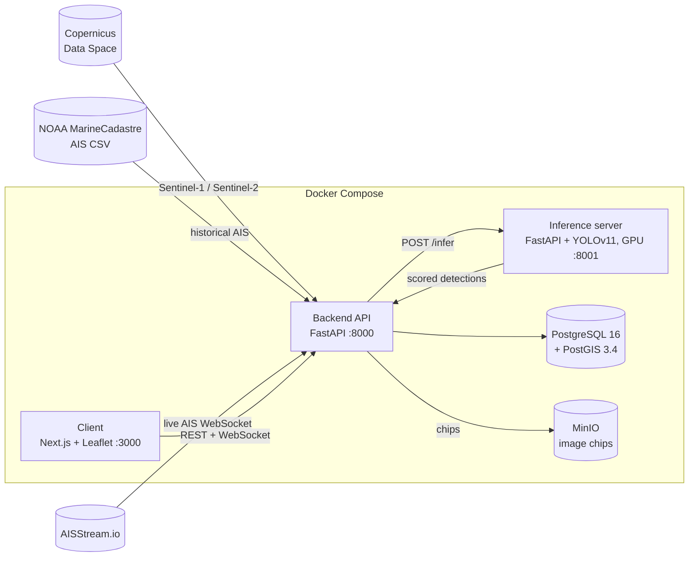

# Kitagawa: Maritime Domain Awareness System

Kitagawa detects vessels in Sentinel-1 SAR and Sentinel-2 EO satellite imagery, correlates each detection with AIS (Automatic Identification System) tracks, and flags "dark" vessels: ships that a satellite sees but that do not transmit AIS. Results go to PostGIS and show on an interactive map with live AIS, track playback, and image chips of each detection.

This repository holds the deployable web system (inference server, backend API, and frontend). Model training, dataset preparation, and benchmarking were done in a separate training repository.

> Built as a B.Tech final-year project, *AI-Powered Defence Systems for Vessel Detection, Classification, and Trajectory Forecasting Using Multi-Sensor Satellite Data*, Department of AI & ML, Dwarkadas J. Sanghvi College of Engineering (University of Mumbai), 2025–26.

---

## Contents

- [Kitagawa: Maritime Domain Awareness System](#kitagawa-maritime-domain-awareness-system)
  - [Contents](#contents)
  - [Features](#features)
  - [Architecture](#architecture)
  - [Processing pipeline](#processing-pipeline)
  - [Models and results](#models-and-results)
  - [Repository layout](#repository-layout)
  - [Getting started](#getting-started)
    - [Prerequisites](#prerequisites)
    - [Run](#run)
    - [Process a scene manually](#process-a-scene-manually)
  - [Configuration](#configuration)
  - [API reference](#api-reference)
  - [Local development](#local-development)
  - [Database migrations](#database-migrations)
  - [Testing](#testing)
  - [Limitations](#limitations)
  - [Team](#team)
  - [License](#license)

---

## Features

- **Multi-sensor vessel detection.** Fine-tuned YOLOv11 models for Sentinel-1 SAR (all-weather, day and night) and Sentinel-2 EO (high detail in clear daylight).
- **Automatic ingestion.** Polls the Copernicus Data Space catalogue for new Sentinel-1 IW GRDH and Sentinel-2 L1C scenes, then downloads and processes them through a queue.
- **AIS correlation.** Matches each detection to the AIS track position interpolated at the exact capture time, using PostGIS spatio-temporal queries.
- **Dark-vessel alerts.** Detections with no AIS match become alerts, so analysts can find ships that have switched off their transponders.
- **False-positive control.** Geometry checks, soft-NMS, a GSHHG land mask, and a ConvNeXt-Tiny cloud classifier for EO scenes.
- **Label-free confidence scoring.** Temperature-scaled calibration, an adaptive Otsu threshold per image, and a context-aware situation score.
- **Live AIS.** Optional real-time position feed from [AISStream.io](https://aisstream.io) over WebSocket.
- **Analyst dashboard.** Next.js and Leaflet map with vessel search, layer toggles (EEZ boundaries, shipping lanes, AIS coverage, tracks), time-based playback, and cropped SAR/EO chips for each detection.

## Architecture



| Service | Path | Port | Role |
|---|---|---|---|
| `inference` | [inference/](inference/) | 8001 | Loads both YOLO models at startup. Tiles scenes, runs detection, scores and filters results. Needs an NVIDIA GPU. |
| `backend` | [backend/](backend/) | 8000 | Ingestion, job queue, AIS correlation, chip generation, and the REST/WebSocket API for the client. |
| `postgres` | `postgis/postgis:16-3.4` | 5432 | Detections, AIS tracks, vessel identities, maritime boundaries. |
| `minio` | `minio/minio` | 9000 / 9001 | Object storage for cropped detection chips. 9001 is the web console. |
| `client` | [client/](client/) | 3000 | Analyst dashboard. |

Code shared by the Python services (Pydantic schemas, configuration, naming helpers) is in [shared/](shared/).

## Processing pipeline

Each satellite scene goes through these steps ([backend/api/pipeline.py](backend/api/pipeline.py)):

1. **Queue.** A background poller searches Copernicus every 10 minutes for scenes from the last 12 hours. You can also queue scenes manually with `POST /api/v1/pipeline/run`.
2. **AIS ingest.** Gets the NOAA MarineCadastre daily AIS file for the scene date and bulk-inserts it into PostGIS. Also records whether AIS coverage exists for that date.
3. **Download.** Downloads and extracts the `.SAFE` product from Copernicus Data Space.
4. **Inference** ([inference/](inference/)). The adapter for the sensor tiles the scene and runs YOLO in batches on the GPU:

   | Sensor | Tile | Overlap | Model input | Raw confidence cutoff |
   |---|---|---|---|---|
   | SAR (Sentinel-1 GRD, VV) | 1024 px | none | 128 px | 0.50 |
   | EO (Sentinel-2 L1C, RGB) | 512 px | 32 px | 512 px | 0.80 |

   Boxes are georeferenced (SAR with GCPs, EO with the CRS transform). Each detection gets a timestamp from the scene metadata.
5. **Scoring** ([inference/scoring/](inference/scoring/)).
   - `calibrated_confidence`: temperature scaling (SAR T = 1.5, EO T = 1.3), then an Otsu threshold per image.
   - `situation_score`: an adjustment in [-0.3, +0.3] from zone, time of day, and sensor context.
   - `final_score = clip(calibrated + situation, 0, 1)`.
6. **Filtering** ([inference/filters/pipeline.py](inference/filters/pipeline.py)). Aspect-ratio, area, and size checks, then soft-NMS, then the GSHHG full-resolution land mask, then the ConvNeXt-Tiny cloud mask (EO only).
7. **Persist and chip.** Detections with a score of 0.10 or more go to PostGIS. A chip is cropped around each detection and uploaded to MinIO.
8. **Correlate** ([backend/services/correlation.py](backend/services/correlation.py)). For each detection, the AIS segment that brackets the capture time is linearly interpolated to that instant. The nearest vessel within **±5 minutes and 200 m** is assigned (MMSI and vessel name). Unmatched detections get a generated name, for example "Iron Bear".
9. **Classify.** The API reports a vessel as **identified** if it is AIS-matched within 500 m, and **unidentified (dark)** if not. Unmatched detections with confidence 0.5 or more in the last 48 hours appear as alerts.

Progress for each stage is broadcast on `ws://<backend>/api/v1/pipeline/ws/status`.

## Models and results

Weights are in [inference/models/](inference/models/):

| File | Sensor | Training data |
|---|---|---|
| `sar_best.pt` | Sentinel-1 SAR | Derived from OpenSARShip v2 |
| `eo_best.pt` | Sentinel-2 EO | Custom electro-optical ship dataset |

Both are fine-tuned YOLOv11 models (Ultralytics 8.3). The EO cloud-mask classifier is in [inference/filters/](inference/filters/) as split zip parts, which are combined and extracted the first time the model loads.

The benchmark results below come from the project report. Rows are listed as reported.

**SAR (Sentinel-1)**

| Model | Accuracy | Precision | Recall | F1 | mAP@0.50 | mAP@0.50:0.95 |
|---|---|---|---|---|---|---|
| Vanilla CNN | 0.5641 | 0.5249 | 0.6584 | 0.5732 | 0.1252 | 0.1042 |
| Faster R-CNN + ResNet50 | 0.7091 | 0.7254 | 0.5498 | 0.6984 | 0.2243 | 0.2541 |
| Faster R-CNN + ResNet18 + FPN | 0.7323 | 0.7437 | 0.8586 | 0.7970 | 0.5062 | 0.3257 |
| YOLOv8n | 0.8065 | 0.7739 | 0.7837 | 0.7788 | 0.8470 | 0.4021 |
| YOLOv8l | 0.8579 | 0.7969 | 0.8049 | 0.8009 | 0.8614 | 0.4165 |
| YOLOv10n | 0.9344 | 0.9220 | 0.9160 | 0.9190 | 0.9260 | 0.4990 |
| YOLOv11l | 0.9572 | 0.9365 | 0.9467 | 0.9468 | 0.9432 | 0.4996 |
| **YOLOv11n (Grad-CAM optimized)** | **0.9951** | **0.9700** | **0.9824** | **0.9826** | **0.9786** | **0.5224** |

**EO (Sentinel-2)**

| Model | Accuracy | Precision | Recall | F1 | mAP@0.50 | mAP@0.50:0.95 |
|---|---|---|---|---|---|---|
| Vanilla CNN | 0.1832 | 0.1875 | 0.1826 | 0.1853 | 0.0751 | 0.0267 |
| Faster R-CNN + ResNet18 | 0.6314 | 0.7039 | 0.5897 | 0.6418 | 0.5806 | 0.1954 |
| YOLOv8l | 0.5682 | 0.7200 | 0.4110 | 0.5237 | 0.4702 | 0.2050 |
| YOLOv8n | 0.6427 | 0.6630 | 0.6150 | 0.6381 | 0.6490 | 0.2792 |
| YOLOv10l | 0.6189 | 0.6148 | 0.6204 | 0.6176 | 0.5381 | 0.3768 |
| YOLOv10n | 0.7823 | 0.8290 | 0.7220 | 0.7718 | 0.7450 | 0.3430 |
| YOLOv11l | 0.8016 | 0.8480 | 0.7573 | 0.8241 | 0.8236 | 0.3590 |
| **YOLOv11n (Grad-CAM optimized)** | **0.9250** | **0.9020** | **0.7985** | **0.8473** | **0.8413** | **0.4935** |

EO recall is lower than SAR recall. Cloud cover, sun glint, and water texture make optical detection harder.

## Repository layout

```
.
├── backend/              FastAPI backend
│   ├── api/              REST + WebSocket routers
│   ├── services/         ingestion, correlation, chips, live AIS, boundaries
│   ├── db/               SQLAlchemy/GeoAlchemy2 models and async engine
│   ├── alembic/          schema migrations
│   ├── scripts/          DB check and load-test helpers
│   └── tests/            API performance checks (need a running stack)
├── inference/            GPU inference server
│   ├── adapters/         SAR / EO sensor adapters (tiling, georeferencing, timing)
│   ├── scoring/          calibration, situation score, FP/FN reduction
│   ├── filters/          filter pipeline + cloud-mask weights (split zip)
│   ├── models/           YOLO weights (sar_best.pt, eo_best.pt)
│   └── tests/            unit tests for scoring
├── client/               Next.js 16 + React 19 + Leaflet dashboard
├── shared/               schemas, config, utilities used by both Python services
├── scripts/migrate.sh    Alembic helper
└── docker-compose.yml    full stack
```

## Getting started

### Prerequisites

- Docker with Compose v2
- NVIDIA GPU, driver, and [NVIDIA Container Toolkit](https://docs.nvidia.com/datacenter/cloud-native/container-toolkit/) (the `inference` service reserves one GPU)
- A free [Copernicus Data Space](https://dataspace.copernicus.eu/) account, for satellite downloads
- Optional: an [AISStream.io](https://aisstream.io) API key, for live AIS
- About 20 GB of free disk space. Sentinel scenes are 1–2 GB each, and the backend pauses ingestion when free disk drops below 1 GB.

Recommended hardware (from the project report): 8-core CPU, 24 GB RAM, 16 GB VRAM. The minimum is a 4-core CPU, 8 GB RAM, and 4 GB VRAM.

### Run

```bash
git clone https://github.com/RaghavGohil/kitagawa-backend.git
cd kitagawa-backend

# Credentials (read by docker compose from .env)
cat > .env <<'EOF'
COPERNICUS_USERNAME=you@example.com
COPERNICUS_PASSWORD=your-password
AISSTREAM_API_KEY=            # optional
EOF

docker compose up --build
```

| URL | Service |
|---|---|
| http://localhost:3000 | Dashboard |
| http://localhost:8000/docs | Backend OpenAPI docs |
| http://localhost:8001/docs | Inference OpenAPI docs |
| http://localhost:9001 | MinIO console (`minioadmin` / `minioadmin`) |

The first build downloads the GSHHG land mask, EEZ boundaries, and shipping-lane layers into the images. The backend waits until the inference server is healthy, and the first model load can take a minute.

Persistent data (Postgres, MinIO, scene downloads) is kept in `./.docker_data/`. To start again from empty, stop the stack and delete that folder.

> The default database and MinIO credentials in `docker-compose.yml` are for local use only. Change them before you expose the stack to a network.

### Process a scene manually

```bash
curl -X POST http://localhost:8000/api/v1/pipeline/run \
     -H "Content-Type: application/json" \
     -d '["S1A_IW_GRDH_1SDV_20250314T224224_20250314T224249_058307_073531_C234.SAFE"]'
```

Track progress with `GET /api/v1/pipeline/status` or on the WebSocket.

## Configuration

All settings come from environment variables ([shared/config.py](shared/config.py)).

| Variable | Default | Purpose |
|---|---|---|
| `COPERNICUS_USERNAME` / `COPERNICUS_PASSWORD` | — | Copernicus Data Space login. Without it, search and download are skipped. |
| `AISSTREAM_API_KEY` | — | Turns on the live AIS feed |
| `AISSTREAM_BBOX` | `[[[-90,-180],[90,180]]]` | Live AIS subscription boxes (JSON) |
| `AISSTREAM_AUTO_START` | `true` | Starts the live feed at boot if a key is set |
| `DISABLE_AUTO_INGEST` | unset | If set, turns off the Copernicus poller and the queue worker |
| `AIS_MIN_LON` / `AIS_MAX_LON` / `AIS_MIN_LAT` / `AIS_MAX_LAT` | world | Clips NOAA AIS rows on insert |
| `SAR_TEMP` / `EO_TEMP` | `1.5` / `1.3` | Calibration temperatures |
| `POSTGRES_HOST` / `PORT` / `DB` / `USER` / `PASSWORD` | `postgres` / `5432` / `kitagawa` ×3 | Database |
| `MINIO_ENDPOINT` / `ACCESS_KEY` / `SECRET_KEY` / `BUCKET` / `SECURE` | `minio:9000` / `minioadmin` ×2 / `kitagawa-chips` / `false` | Chip storage |
| `INFERENCE_SERVER_URL` | `http://inference-server:8001` (Compose sets `http://inference:8001`) | Backend → inference |
| `DATA_DIR` | `/data` | Scene, AIS, and detection workspace |
| `MASK_DIR` | `/app/landmask` | GSHHG land mask location |
| `NEXT_PUBLIC_API_URL` | `http://localhost:8000` | Backend URL used by the client. Set at build time. |

## API reference

Interactive docs are at `/docs` on each service. Main backend routes (all under `/api/v1`):

| Method | Path | Description |
|---|---|---|
| GET | `/detections` | Detections in a bounding box (`min_lon`, `min_lat`, `max_lon`, `max_lat`, `zoom`, `sensor_type`). Clustered when zoom is below 10. |
| GET | `/detections/{id}` | One detection |
| GET | `/vessels` | Vessels with classification, for the map and explorer |
| GET | `/vessels/{mmsi}` | Vessel details and detection history (a negative id means an unidentified detection) |
| GET | `/vessels/chips/{detection_id}` | Pre-signed URL for a detection chip |
| GET | `/ais/tracks` | AIS tracks in a time and space window |
| GET | `/ais/tracks/{mmsi}` | Track for one vessel |
| GET | `/ais/coverage-grid` | AIS coverage grid |
| GET / POST | `/ais/live/status`, `/ais/live/start`, `/ais/live/stop` | Live AIS feed control |
| GET | `/ais/live/positions` | Latest live positions |
| WS | `/ais/live/ws` | Live AIS position stream |
| GET | `/alerts` | Recent dark-vessel alerts |
| GET | `/stats` | Dashboard counters |
| GET | `/boundaries` | EEZ and other maritime boundaries |
| GET | `/config/classification` | Classification states, colors, and labels for the UI |
| POST | `/correlate/{detection_id}` | Re-runs AIS correlation for one detection |
| POST | `/pipeline/run` | Queues scene names (JSON array) |
| GET | `/pipeline/status` | Queue and stage progress |
| POST | `/pipeline/reset` | Clears the queue and resets the status |
| WS | `/pipeline/ws/status` | Pipeline progress stream |

Inference server: `POST /infer` (one `.SAFE` folder, or a product name to download), `POST /infer/batch`, `GET /progress`, `GET /health`.

## Local development

Start the stateful services in Docker, and run the apps on the host:

```bash
docker compose up -d postgres minio

# Backend (from repo root, so `backend` and `shared` import as packages)
pip install -r backend/requirements.txt
POSTGRES_HOST=localhost MINIO_ENDPOINT=localhost:9000 \
INFERENCE_SERVER_URL=http://localhost:8001 DATA_DIR=./data \
uvicorn backend.main:app --reload --port 8000

# Inference (needs CUDA PyTorch, GDAL, and the GSHHG land mask at MASK_DIR)
pip install -r inference/requirements.txt
DATA_DIR=./data MASK_DIR=./landmask uvicorn inference.main:app --port 8001

# Client
cd client && npm install && npm run dev
```

Use `DISABLE_AUTO_INGEST=1` on the backend to stop it from downloading scenes while you develop.

## Database migrations

The tables are created at startup. Use Alembic for schema changes:

```bash
./scripts/migrate.sh generate "describe change"   # autogenerate from models
./scripts/migrate.sh upgrade                       # apply to head
./scripts/migrate.sh downgrade -1
./scripts/migrate.sh history
```

## Testing

```bash
# Scoring unit tests (no services needed)
python -m pytest inference/tests/test_scoring.py -v

# API performance checks (need the stack running on :8000)
python -m pytest backend/tests -v
```

CI ([.github/workflows/ci.yml](.github/workflows/ci.yml)) runs the backend tests against a PostGIS service container, with auto-ingest turned off.

## Limitations

- Small craft (less than about 10 m) can be below the SAR noise floor, and detection near harbours and coastlines is weaker.
- Sentinel revisit intervals (Sentinel-1: 6–12 days, Sentinel-2: about 5 days) give snapshots, not continuous tracks.
- Historical AIS comes from NOAA MarineCadastre, which covers US waters. Detections in other regions are only correlated through live AIS.
- The models were evaluated on a limited regional dataset and may need retraining to generalise to other regions.

Planned work: multi-object tracking across passes (Kalman or deep trackers), trajectory forecasting, AIS-spoofing detection, and wider training data.

## Team

- Tilak Devi
- Raghav Gohil
- Parth Rana
- Jinnal Raghwani

Guide: **Dr. Aruna Gawade**, Associate Professor and Head of Department, AI & ML, Dwarkadas J. Sanghvi College of Engineering, Mumbai.

The work is registered with the Copyright Office, Government of India, under Registration No. **LD-20260193507** (registered 6 August 2026; application LD-6392/2026-CO).

## License

[GPL-3.0](LICENSE).
